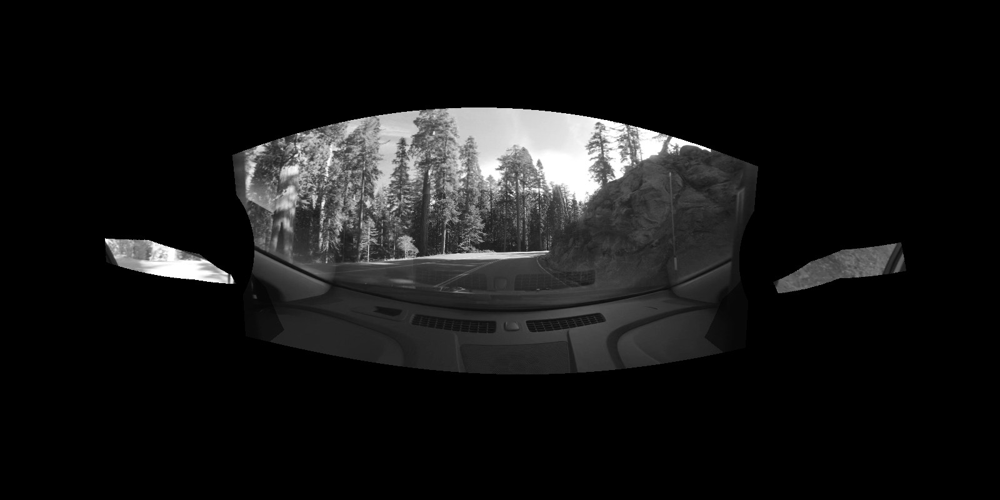

# Openpilot drive stitching



A 4K frame from a forest drive, reduced to 1600×800 for this page. Three comma four cameras are
projected into one equirectangular view with the calibration in `rig/calibration.json`: the cabin
camera contributes only scenery seen through the door windows, so the occupants and the rest of the
interior are never drawn. Black is space no camera sees. Timestamps are omitted here but present in
the rendered videos. Regenerate with
`uv run rig_samples.py rig/calibration.json --anonymize --width 1600 --output previews/anon SEGMENT:FRAME`.

From the repository root:

```sh
uv sync
uv run stitch.py rig/calibration.json --output videos-4k --jobs 3 --resume
```

Use `--drive ROUTE` to render a single route or `--segment SEGMENT --frames 40 --output previews` for a short check. The batch sorts each route numerically by segment, skips unreadable or incomplete segments, and publishes `ROUTE.mp4` in the output directory after the route finishes. Check the render log for gaps. No frames are fabricated for missing segments.

Rendering is serial within each drive (`--jobs` caps concurrent drives): rlogs are decompressed one message at a time, camera frames are piped from FFmpeg and composited one output frame at a time, and each encoded segment goes directly to disk. Decoders and frame buffers are released after each segment. Temporary segment MP4s are deleted after concatenation. Allow disk space for two copies of each active drive during concatenation or metadata injection. `--resume` skips already published drives; use a fresh output directory when changing calibration.

The camera calibration is `rig/calibration.json`; see `RIG_CALIBRATION.md` for how it was fitted and validated. The approaches that did not work, and why, are listed in `FAILED_ATTEMPTS.md`.

The default output is 4096×2048 (2:1 equirectangular), with a UTC ISO 8601 timestamp in an uncovered region. The final MP4 is tagged as monoscopic spherical equirectangular using Google's Spatial Media tool. If the headset player ignores the tag, select monoscopic 360° mode manually. Where wide and cabin overlap they are averaged 50/50; the narrow road image is drawn on top of the wide image. Areas outside every camera are black; camera translation/parallax and occlusions are not corrected.

Frame timestamps come from the rlog encoder indices and are placed on the UTC clock using rlog clock events (or init data when needed). Sampled `dcamera.hevc` is video only. Audio is AAC in `qcamera.ts`; the qRoad encode timestamp anchors it to the camera timeline. Segments without usable audio get silence. The rlog `Microphone` event in the upstream schema contains sound levels, not waveform samples.

Schemas are adapted from commaai/openpilot revision `ff300ecf785152db7a518ffd959871dab6b6e6d1`; unused vehicle type references are stubbed for standalone log reading.

## License

Everything here is released into the public domain under the [Unlicense](UNLICENSE); no attribution is required.

The Cap'n Proto schemas in `schemas/` are vendored from [commaai/openpilot](https://github.com/commaai/openpilot) and remain under its MIT license, reproduced in `schemas/LICENSE`.
